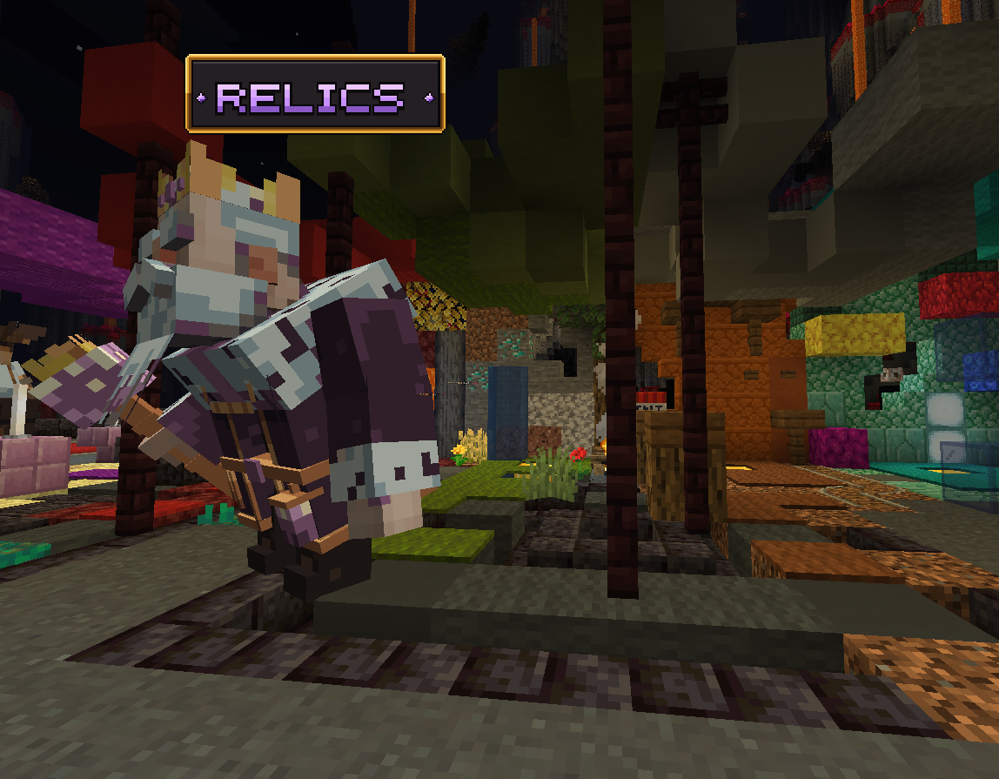

<div align="center">

# ⛏️ MegaMine Wiki — Rinaorc

**Le wiki communautaire du mode MegaMine sur le serveur Minecraft [Rinaorc](https://rinaorc.com).**

### 👉 [Lire le wiki en ligne](https://arthurecodage.github.io/megamine-wiki/)




</div>

## Ce que tu y trouves

- 🚀 **Guide du débutant** : bien démarrer, les étages, les Mondes 1 ★ à 10 ★★★, les multiplicateurs de vente
- ✨ **Les 46 compétences** et leurs livres
- 🌌 **L'arbre du Tesseract** (373 talents) et les nœuds légendaires
- 🐾 **Les 117 familiers** à collectionner
- 💀 **Boss PvE** et le Seigneur des Abysses
- 🏆 **Mode Duel 1v1** (`/duel`, dès le niveau 50) : bans, mondes jumeaux, rangs
- 🛡️ Équipement et historique des mises à jour

## Contribuer

Une info manquante ou fausse ? Ouvre une [issue](https://github.com/ArthureCodage/megamine-wiki/issues) ou une pull request :
les pages sont de simples fichiers Markdown dans [`docs/`](docs).

### Lancer le site en local

```bash
npm install
npm run docs:dev      # http://localhost:5173
npm run docs:build    # build de production
```

Chaque push sur `main` met le site en ligne automatiquement sur GitHub Pages (workflow `.github/workflows/deploy.yml`).

---

<sub>Wiki de fans, non officiel, sans lien avec l'équipe de Rinaorc.</sub>
