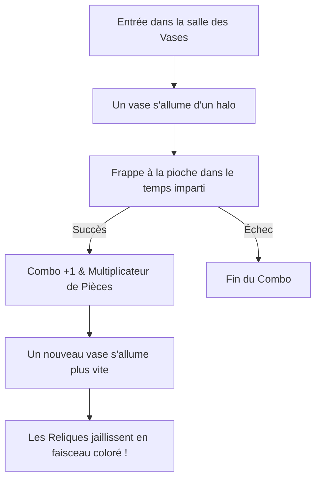

# Reliques & La Frénésie des Vases

Les **Reliques** sont des artéfacts anciens qui octroient des pouvoirs passifs exceptionnels et transforment radicalement le cours d'une partie.

---

## 🏺 Le Mini-jeu : La Frénésie des Vases

Fini les clés d'ouverture et les temps d'attente passifs : la salle des vases est désormais un **mini-jeu d'adresse et de réflexe ultra-rythmé** !

### Règles de la Frénésie
1. Dès que vous pénétrez dans la salle, **un seul vase s'allume**.
2. Frappez-le avec votre pioche avant que son halo lumineux ne s'éteigne !
3. Chaque coup réussi augmente votre jauge de **COMBO (ex: Combo $\times 12$)** et multiplie la quantité de pièces récoltées.
4. Le vase suivant s'allume instantanément ailleurs dans la pièce, à un rythme de plus en plus effréné.
5. Les reliques jaillissent du sol dans un faisceau lumineux arborant la couleur de leur rareté avant de voler directement vers votre inventaire.

> [!TIP]
> **Le Vase Doré** : Une salle sur cinq renferme un **vase doré secret** garantissant une **Relique Épique** si vous maintenez votre enchaînement !

---

## 💎 Raretés & Reliques Notables

| Rareté | Couleur du Faisceau | Niveau de Puissance |
| :--- | :--- | :--- |
| **Commune** | Blanc / Gris | Bonus légers de confort et de stats. |
| **Rare** | Bleu / Cyan | Multiplicateurs de blocs et bonus d'invocations. |
| **Épique** | Violet | Effets de rupture et puissants dégâts de zone. |
| **Légendaire** | Doré / Ambre | Altérations majeures des règles du jeu. |

### Les Reliques Légendaires Incontournables
* **Main avide** : Nécessite seulement 5 exemplaires d'une relique rare (au lieu de 25 auparavant) pour synthétiser des effets supérieurs.
* **Combo éternel** : Maintient vos bonus de frénésie même lors des temps morts entre deux salles.
* **Double coup** : Vous octroie une probabilité continue de dupliquer instantanément vos frappes et vos tirs magiques.
* **Passe-partout** : Franchit instantanément toutes les barrières et portes scellées sans pénalité.
