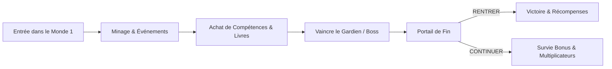

# Guide du Débutant & Premiers Pas

Bienvenue dans **MegaMine** sur Rinaorc ! Si vous venez d'arriver sur le serveur, ce guide va vous expliquer le fonctionnement global d'une partie et les bases indispensables pour progresser efficacement.

---

## 🎯 Le Concept de MegaMine

MegaMine est un mode hybride combinant :
1. **Mining & Incrémental** : Vous commencez avec une pioche de base pour miner la roche et les minerais précieux (charbon, fer, or, diamant, netherrack, etc.).
2. **Rogue-lite en Partie** : Chaque partie se déroule par **Étages** (1 à 3 Étages consécutifs). Chaque Étage génère un monde neuf avec ses filons, ses coffres, ses événements et ses boss.
3. **Méta-progression Permanente** : Les pièces gagnées en partie peuvent être converties ou utilisées pour débloquer des **Éclats (Shards)**, faire monter votre **Niveau de Compte**, monter l'arbre du **Tesseract**, améliorer vos outils à la **Forge** et collectionner les **117 Familiers**.

---

## 🖥️ Comprendre son Interface (HUD)

L'interface de MegaMine regroupe toutes les informations essentielles au bon déroulement de votre expédition :

### 1. En Haut à Gauche : Progression de Compte & Chronomètre
* **Couronne & Niveau de Compte** : Votre niveau global. Chaque niveau franchi vous octroie **1 point de talent** à investir dans l'arbre céleste du Tesseract.
* **Jauge d'XP de Profil** : Affiche votre progression vers le niveau de compte supérieur.
* **Chronomètre d'Étage** : Décompte le temps restant avant la fin de l'Étage en cours ou le déclenchement d'un événement.

### 2. Sur le Flanc Gauche : Les Familiers Actifs
* Affiche votre équipe de **familiers équipés** (jusqu'à 5 simultanément).
* **Étoiles d'Évolution** : Indiquent le palier de rareté et de puissance du compagnon (de 1 à 5 étoiles).
* **Jauge d'Expérience** : Chaque familier gagne sa propre expérience lorsqu'il mine et combat à vos côtés.

### 3. En Haut à Droite : Économie & Puissance
* **💎 Riozs** : Monnaie générale du réseau Rinaorc pour les cosmétiques et la boutique.
* **⭐ Shards (Éclats)** : Ressource permanente fondamentale pour la méta-progression (améliorations de Forge $+16$ à $+20$, Tesseract et agrandissement du Coffre).
* **🗡️ Power (Puissance)** : Indicateur chiffré synthétisant la force globale de votre compte (équipement, familiers, reliques, stats passives).
* **🏆 Record** : Montant record de pièces générées sur votre meilleure partie enregistrée.

### 4. En Bas au Centre : Survie & Outils
* **Barre de Points de Vie** : Vos PV actuels. Vous pouvez transporter jusqu'à **3 fioles de vie** en réserve.
* **Jauge d'Énergie / Mobilité** : Capacité de votre sac à dos ou jauge de poussée de votre jetpack.
* **Barre d'Action** : Emplacement de votre pioche, multi-outils et consommables.

---

## 🔄 Déroulement d'une Partie Typique

1. **Le Lancement** : Vous apparaissez sur l'Étage 1. Vos familiers attendent votre premier coup de pioche avant de se mettre à miner.
2. **Minage & Compétences** : Chaque bloc cassé rapporte de l'argent. Très vite, vous débloquez vos premières compétences (sorts de minage automatique, tirs de dynamite, tremblements de terre).
3. **Les Salles Spéciales** :
   * **Frénésie des Vases** : Tapez sur les vases allumés avant que leur halo ne s'éteigne pour faire monter un combo et gagner des reliques rares !
   * **Coffres Maudits** : Survissez aux vagues d'ennemis pour obtenir un butin colossal.
   * **Sanctuaires** : Offrent des choix de bénédictions ou d'altérations.
4. **Le Boss d'Étage** : Un boss apparaît. Esquivez ses patterns d'attaque, utilisez vos fioles de vie à bon escient et abattez-le.
5. **Le Portail** : Après le boss, le portail ne se brise plus. Vous avez le choix :
   * **RENTRER** : Sécuriser votre partie, vos gains d'XP et vos Éclats.
   * **CONTINUER** : Vous aventurer dans la survie bonus pour battre vos records.

---

## 💡 5 Conseils Clés pour Débuter

1. **Ne stockez pas vos fioles au sol** : Vous pouvez transporter jusqu'à 3 fioles de vie. Les ennemis dotés d'affixes en lâchent deux fois plus.
2. **Faites attention aux murs de roche** : Les compétences actives visent automatiquement la roche jusqu'à 40 blocs devant vous. Orientez toujours votre regard vers les filons les plus denses.
3. **Surveillez votre multiplicateur de vente** : Vendre au bon moment permet d'atteindre jusqu'à **$\times 8$ de vente** au maximum !
4. **Activez vos talents dès le niveau 1** : L'accès à l'arbre du Tesseract est gratuit sous le niveau 10 pour réinitialiser vos points si vous changez d'avis.
5. **Collectionnez vos familiers** : Même les familiers de départ augmentent votre Puissance globale et accélèrent la vitesse de minage.
