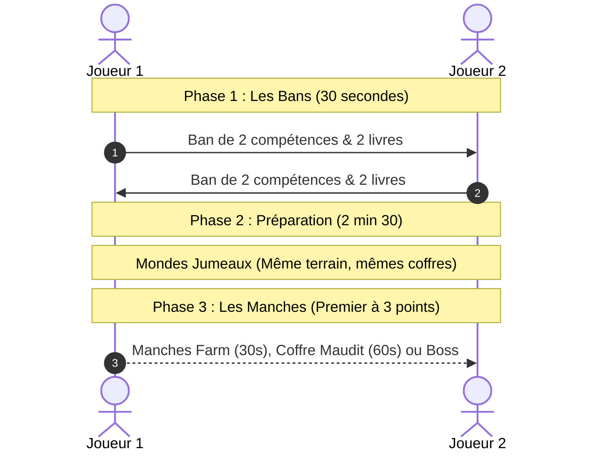

# Le Mode Duel 1v1 Compétitif

Ouvert à tous les joueurs dès le **niveau 50**, le **Mode Duel** (`/duel`) est l'arène compétitive de MegaMine. Deux mineurs s'affrontent indirectement dans des mondes jumeaux pour prouver qui possède le meilleur build et la meilleure réactivité.

---

## ⚔️ Le Déroulement d'un Match



### 1. La Préparation & Les Bans (Draft)
* **Votre Deck** : Vous sélectionnez au préalable **12 compétences**, **12 livres** et votre pioche préférée.
* **Les Bans secrets (30 secondes)** : Chaque joueur inspecte le deck de l'adversaire et lui bannit **2 compétences et 2 livres**.
* Vous disputez le match avec un deck épuré de **4 compétences et 4 livres**.
* ⚠️ *Règle stricte* : **La Pioche Absolue est interdite en Duel**.

### 2. Mondes Jumeaux & Préparation (2 min 30)
Chaque duelliste est téléporté dans sa propre copie conforme de la mine (mêmes minerais, mêmes coffres). Vous disposez de 2 minutes et 30 secondes pour farmer, acheter vos améliorations et préparer votre équipement.

### 3. Le Sanctuaire & Les Malus Adversaires
En activant le Sanctuaire de votre monde, vous choisissez une carte maléfique parmi 3 propositions pour entraver votre rival :
* **Horde** : Fait déferler une meute de monstres supplémentaires chez lui.
* **Silence** : Bloque temporairement le lancement de ses compétences actives.
* **Ailes coupées** : Désactive temporairement son jetpack.
* **Brume** : Réduit drastiquement son champ de vision.

---

## 🎯 Les 3 Types de Manches

| Manche | Durée | Condition de Victoire du Point |
| :--- | :--- | :--- |
| **💰 Farm** | 30 secondes | Le joueur qui accumule le plus d'argent pendant le chrono marque le point. |
| **💀 Coffre Maudit** | 60 secondes | Le joueur qui survit au plus grand nombre de vagues de monstres marque. |
| **👑 Boss** | Sprint | Le même boss apparaît devant chaque joueur. Le premier qui l'achève marque. |

> [!IMPORTANT]
> **Règle de Victoire** : Le premier joueur à marquer **3 points avec 2 points d'avance** remporte le Duel. Mourir au cours d'une manche offre immédiatement le point à l'adversaire.

---

## 🏆 Le Classement & Les Rangs (Ladder)

Après **5 matchs de placement**, vous recevez votre cote en **LP** et votre rang officiel. Votre emblème s'affiche avec fierté **au TAB et dans le tchat** :

```
[Fer] ➔ [Or] ➔ [Émeraude] ➔ [Diamant] ➔ [Netherite] ➔ [Wither] ➔ [Dragon]
```

### Récompenses & Gains Quotidiens
* **Victoire** : **+4 000 Éclats (Shards)** & **+20 000 XP de Compte**.
* **Défaite** : **+1 500 Éclats (Shards)** & **+8 000 XP de Compte**.
* **Plafond Quotidien** : Jusqu'à **10 matchs rémunérés par jour** (les points de LP continuent de progresser au-delà pour monter au classement).
* **Défi Amical** : Utilisez le bouton DÉFIER pour affronter des amis sans gain ni perte de points.
